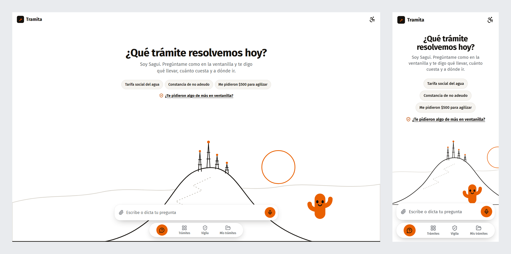
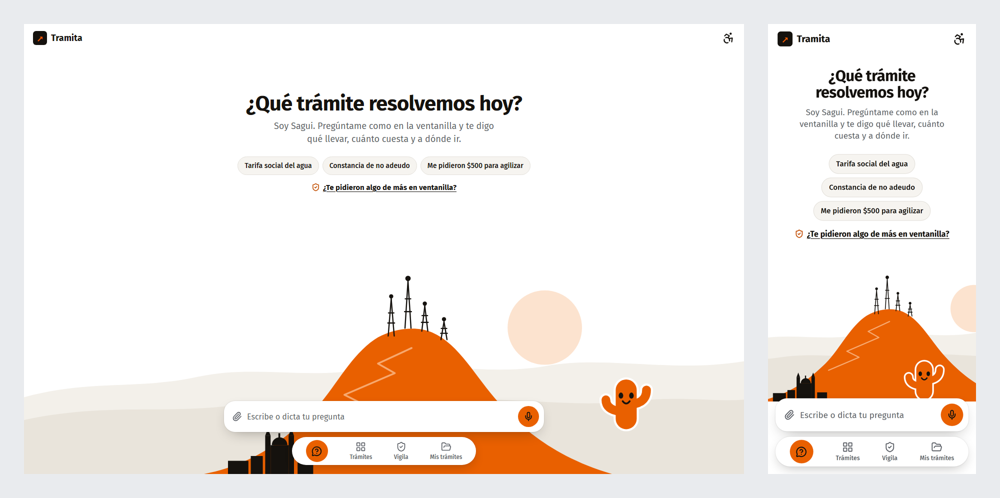
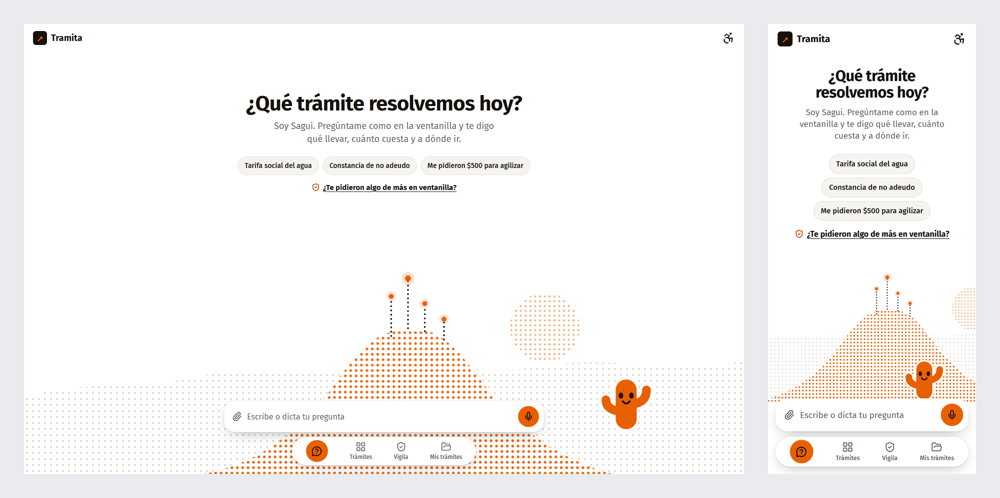
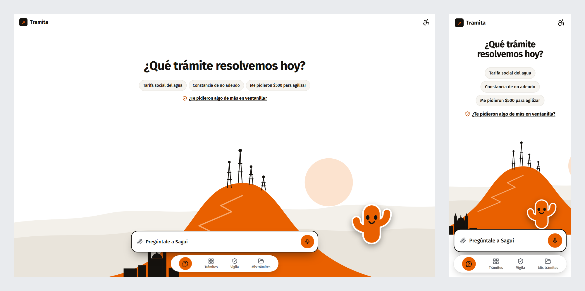

# Propuestas para la pantalla de inicio

Fondo blanco con el Cerro de la Campana minimalista y Sagui de pie al pie del cerro. En cada imagen, la computadora va a la izquierda y el celular a la derecha.

## 1. Trazo

El cerro dibujado con una sola línea de tinta, el camino en zigzag punteado, las antenas con luces naranjas y el sol como un círculo. Es la más ligera: Sagui es lo único con color fuerte.

## 2. Planos

El cerro en el naranja de la marca, la sierra en grises cálidos y la Catedral al pie, como en la realidad. Es la más llamativa y la que más dice "Hermosillo".

## 3. Puntos

El cerro hecho de una trama de puntos naranjas que se desvanece hacia arriba, con antenas punteadas y luces que brillan. Es un guiño al pixel art, pero limpio sobre blanco.

## Elegida: 2 con ajustes

La propuesta 2 sin el texto de presentación. Sagui queda parado en el cerro con contorno blanco y sombra para que destaque sobre el naranja, y la barra del chat lleva borde de tinta, sombra más marcada y la invitación "Pregúntale a Sagui". Es la que está en la app.

