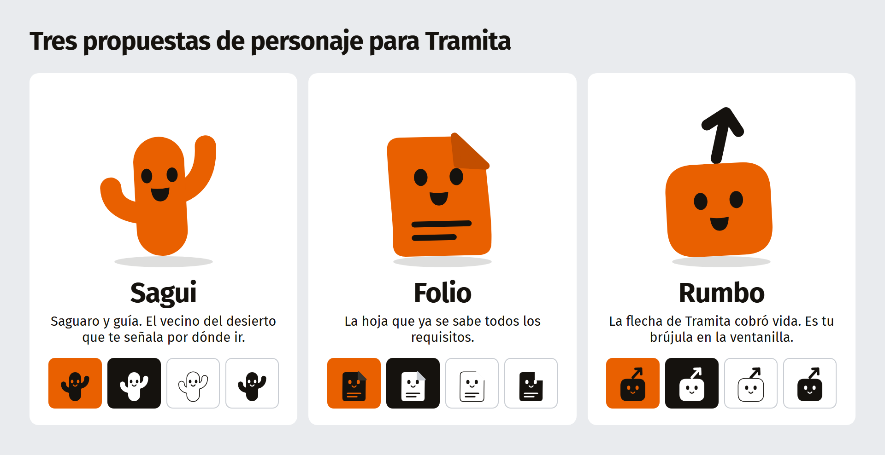
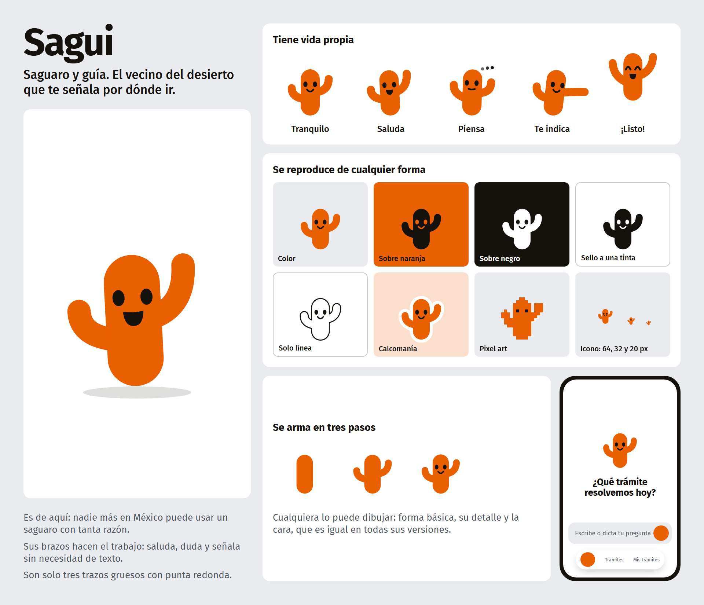
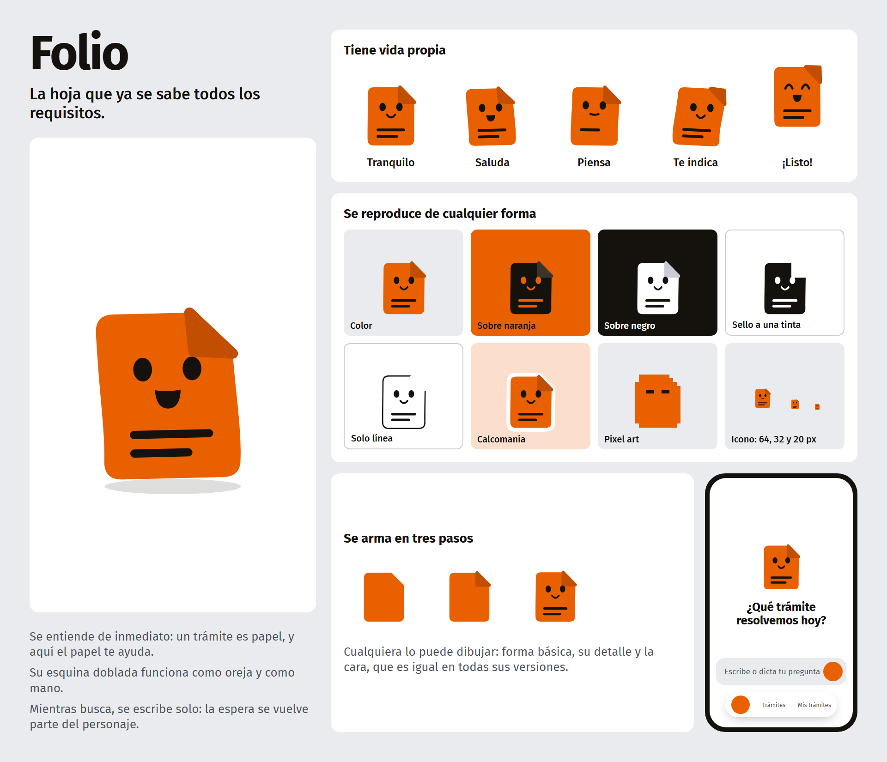
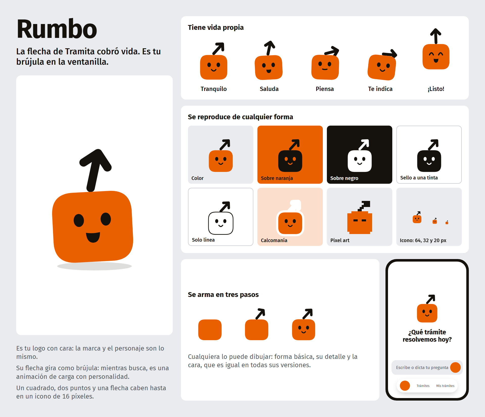

# Propuestas de personaje para Tramita

Tres opciones. Cada una tiene su lámina y un video de 10 segundos con sus cuatro estados: saluda, piensa, te indica y ¡listo!

Video de los tres juntos: [video-comparativo.mp4](video-comparativo.mp4)

## Sagui

Saguaro y guía. El vecino del desierto que te señala por dónde ir.

Video: [video-sagui.mp4](video-sagui.mp4)

## Folio

La hoja que ya se sabe todos los requisitos.

Video: [video-folio.mp4](video-folio.mp4)

## Rumbo

La flecha de Tramita cobró vida. Es tu brújula en la ventanilla.

Video: [video-rumbo.mp4](video-rumbo.mp4)
